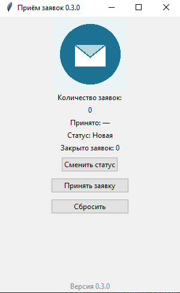
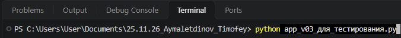
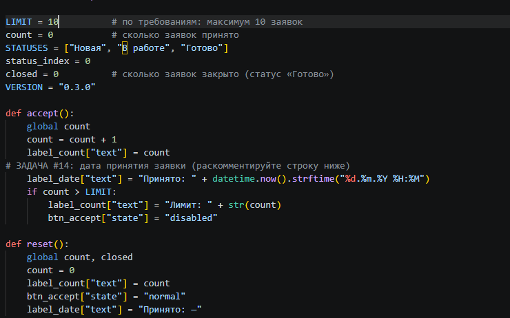
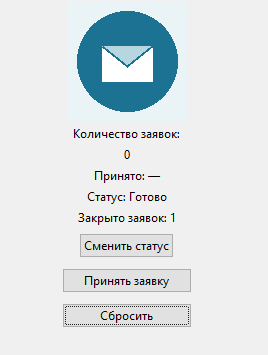

# Тестирование обновлений

## Проэкт

- Название: Приём заявок
- Версия: 0.3.0

## Файлы

- app_v03_для_тестирования.py - приложение,
- logo.png - иконка приложения

## Как запустить

Запустить приложение в файле нажать два раза или через VS в терминале написать "python app_v03_для_тестирования.py"

## Тестирование

В ходе тестирования приложения было обнаружено два дефетка в нём:

1. Кнопка блокируется только на 11-м нажатии, и надпись показывает "Лимит: 11". Один лишний момент проходит мимо лимита.

3. Счётчик закрытых заявок остаётся как был и не сбрасывается кнопкой "Сбросить".

О двух дефектах сообщили разработчичкам.

## Выпуск

Было обнаружено двух дефектов. Приняли решение не выпускать версию 0.3.0. Пока все дефекты не будут исправлены.

### Выполнил

#### Аймалетдинов Тимофей 11ТЭС
